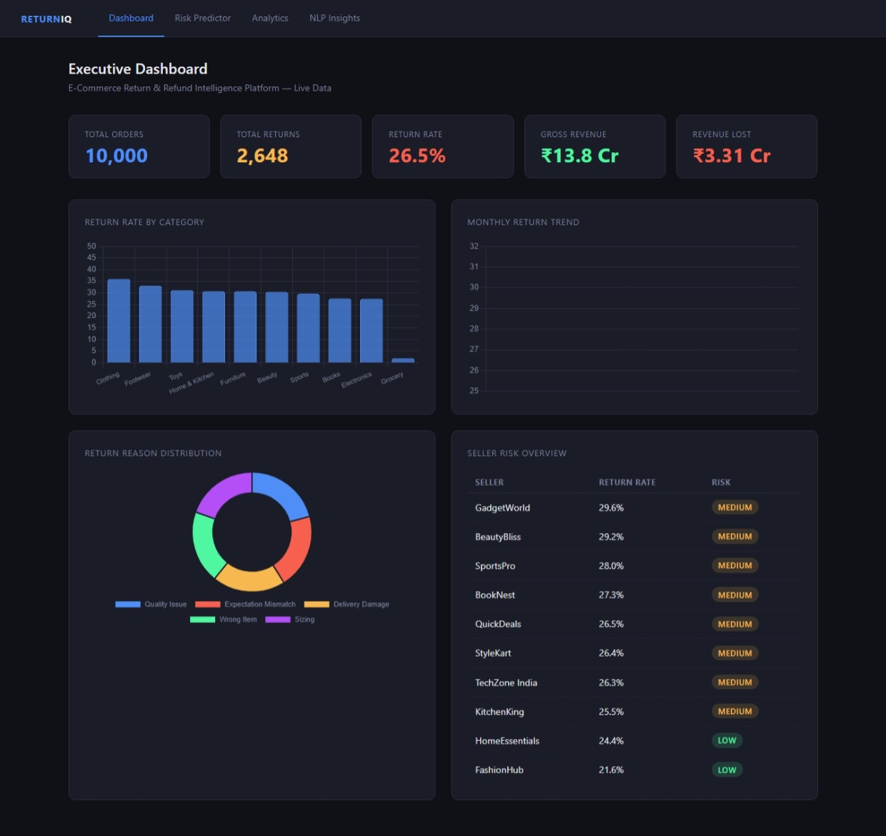
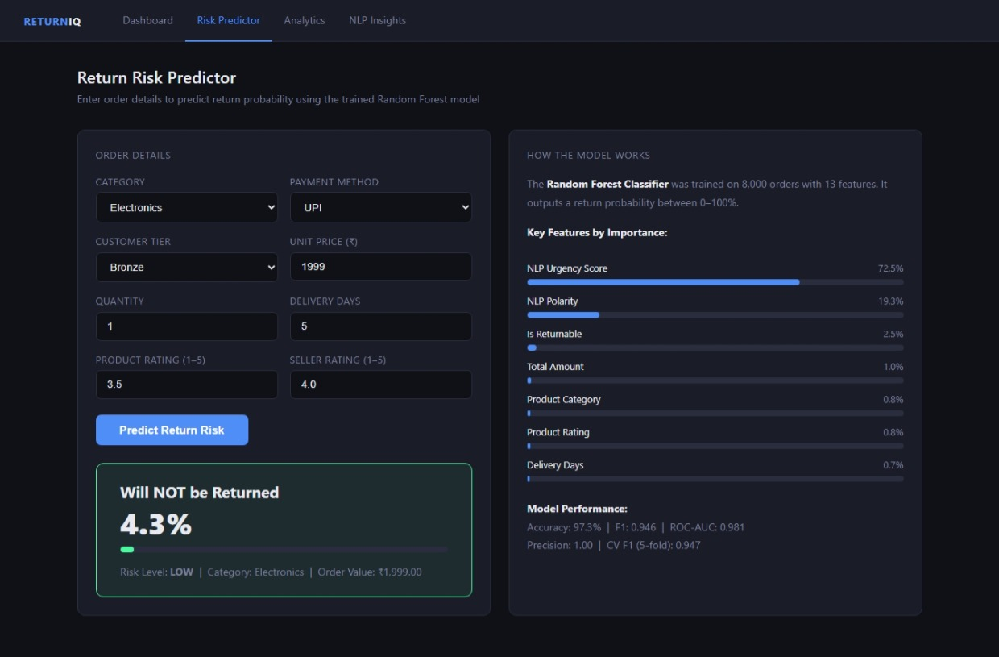
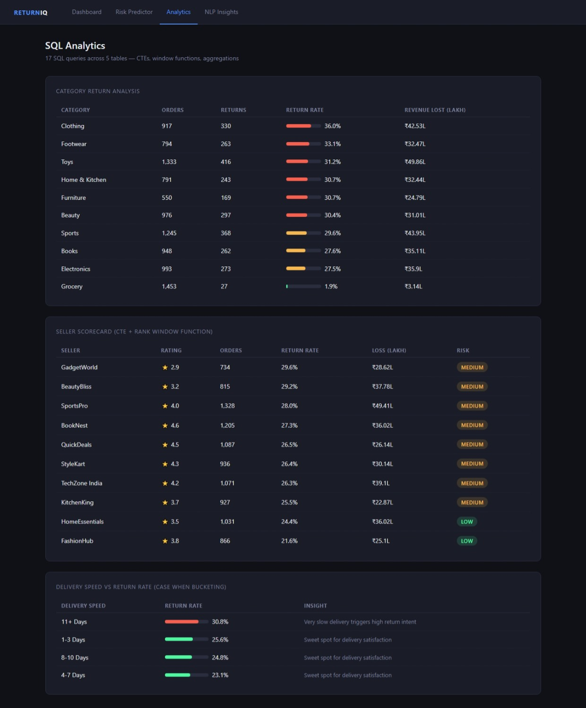
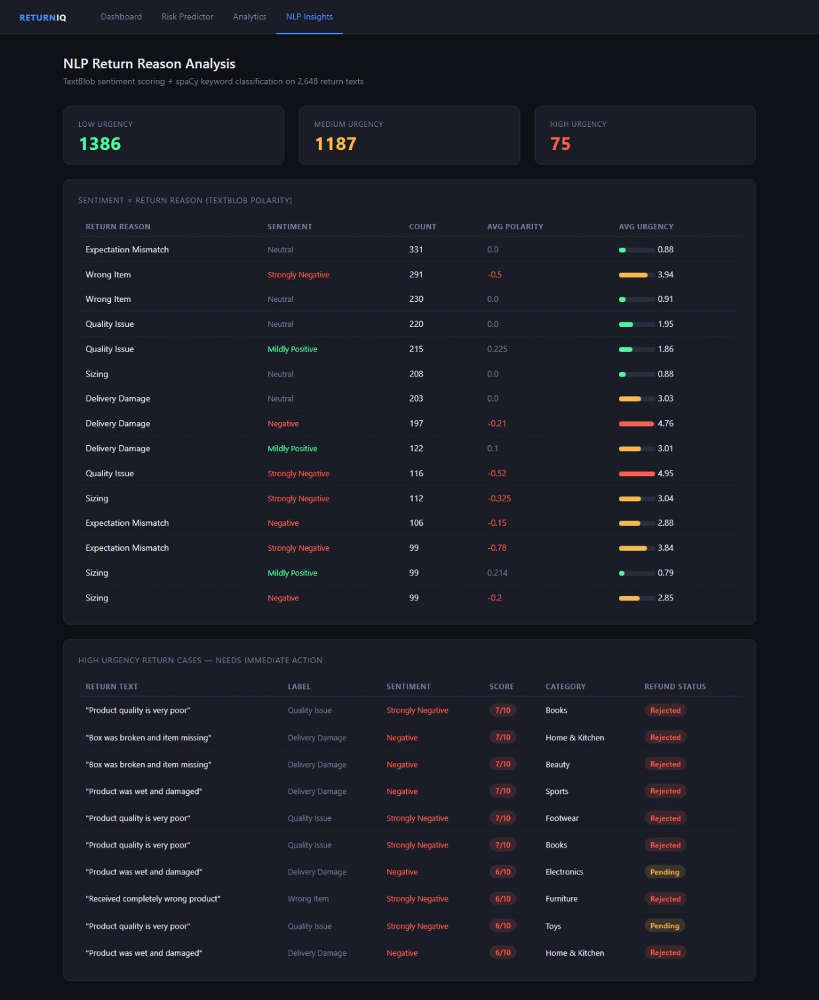
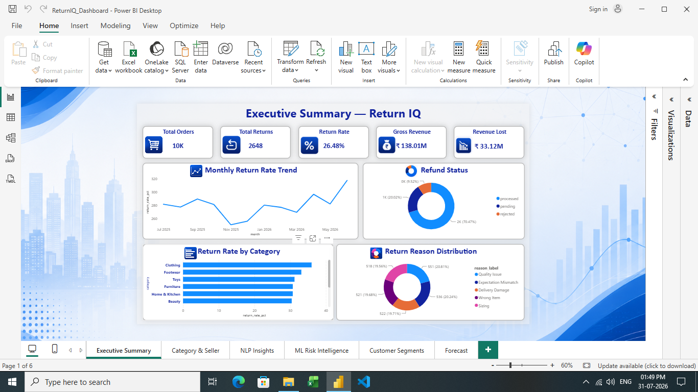
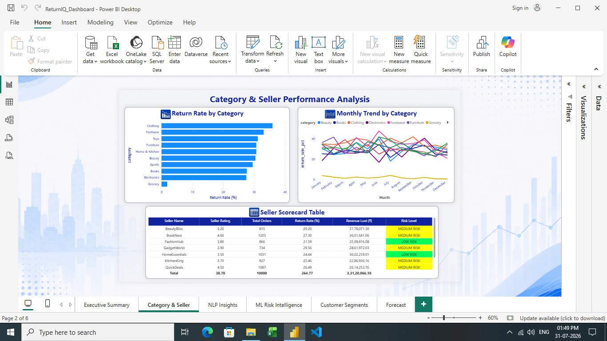
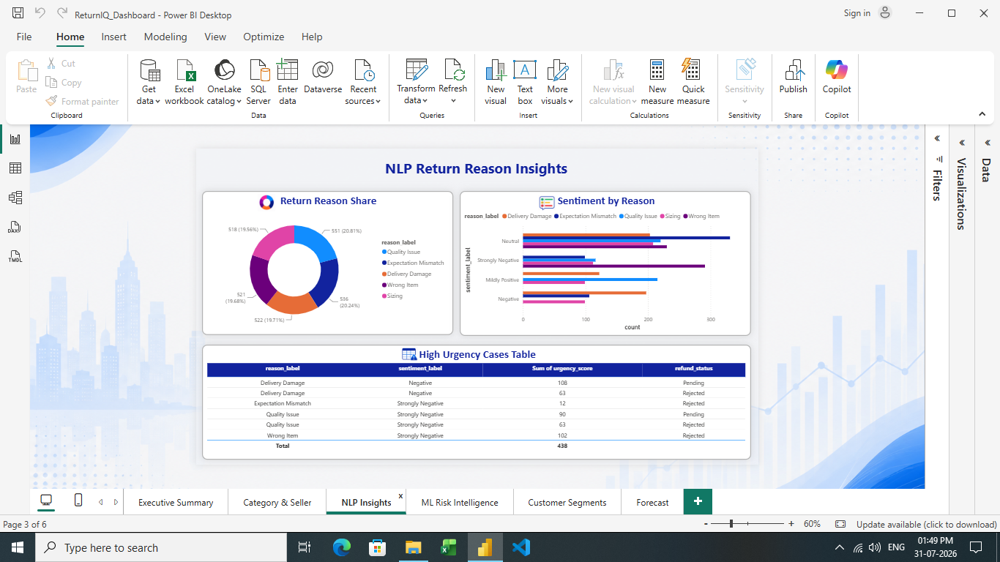
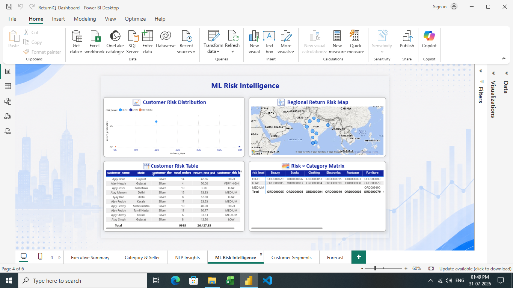
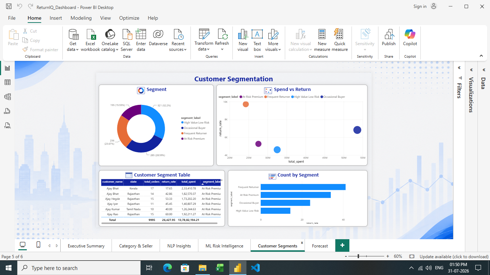
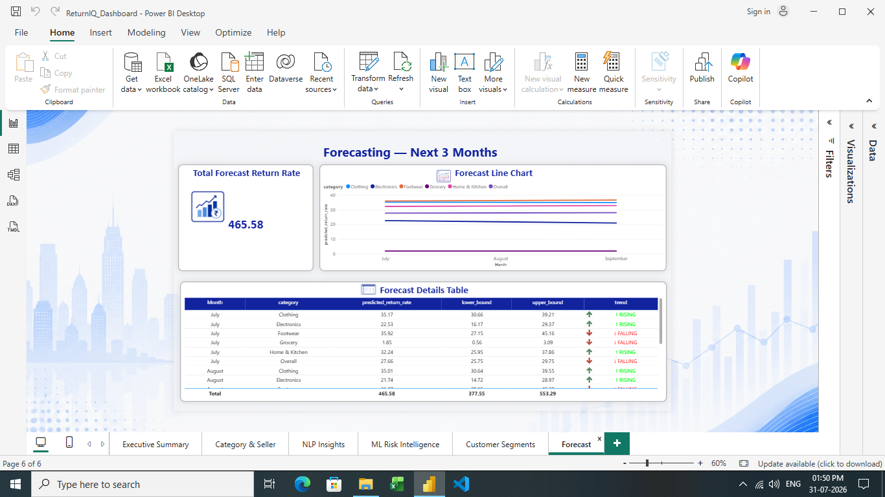

<div align="center">

# ReturnIQ
### E-Commerce Return & Refund Intelligence Platform

**Turning return data into actionable business insights.**

<p>
  
  
  
  
  
</p>

</div>

---

## Overview

ReturnIQ is an e-commerce analytics project that examines order returns, refunds, customer feedback, category trends, and seller performance. It combines SQL analytics, Natural Language Processing (NLP), machine learning, customer segmentation, and forecasting with a Flask interface and Power BI dashboards to support data-driven decisions.

## Key Highlights

| Capability | What it does |
|---|---|
| 📦 Order analytics | Analyzes a project dataset of **10,000 e-commerce orders** |
| 🤖 Return-risk prediction | Uses a **Random Forest** model to estimate order return risk |
| 📝 NLP insights | Analyzes customer return comments using **spaCy** and **TextBlob** |
| 📊 Business intelligence | Presents trends and KPIs through **Power BI dashboards** |
| 👥 Customer segmentation | Applies **K-Means clustering** to group customer behavior |
| 📈 Forecasting | Uses **Prophet** to explore future return trends |
| 🧮 SQL analytics | Uses aggregations, CTEs, and window functions for deeper analysis |

> **Project result:** The analysis estimated ₹3.31 crore in potentially preventable revenue loss within the project dataset. This is a project-derived estimate, not verified real-world savings.

## Tech Stack

- **Language & data analysis:** Python, Pandas, NumPy
- **Database & querying:** SQLite, SQL
- **Web interface:** Flask
- **NLP:** spaCy, TextBlob
- **Machine learning:** scikit-learn, Random Forest
- **Segmentation & forecasting:** K-Means, Prophet
- **Dashboards:** Power BI

## Application Preview

### Executive Dashboard
A high-level view of order volume, returns, return rate, revenue, and category trends.



### Return Risk Predictor
Predicts an order's return probability from order and product attributes.



### SQL Analytics
Category return analysis, seller scorecards, and delivery-speed comparisons.



### NLP Return Reason Insights
Summarizes return reasons, sentiment, urgency, and cases that may need attention.



## Power BI Report

The report is organized into six pages.

<details>
<summary><strong>1. Executive Summary</strong></summary>


</details>

<details>
<summary><strong>2. Category & Seller Analysis</strong></summary>


</details>

<details>
<summary><strong>3. NLP Insights</strong></summary>


</details>

<details>
<summary><strong>4. ML Risk Intelligence</strong></summary>


</details>

<details>
<summary><strong>5. Customer Segments</strong></summary>


</details>

<details>
<summary><strong>6. Forecast</strong></summary>


</details>

## Repository Structure

```text
Return-IQ/
├── README.md
├── .gitignore
├── requirements.txt        # Add project dependencies
├── app.py                  # Add Flask entry point if this is its filename
├── assets/
│   ├── web-dashboard.jpg
│   ├── return-risk-predictor.jpg
│   ├── sql-analytics.jpg
│   ├── nlp-insights.jpg
│   └── powerbi-*.png
├── src/                    # Optional: application and model code
├── sql/                    # Optional: SQL scripts
├── notebooks/              # Optional: analysis notebooks
└── data/                   # Optional: generated/sample data
```

The structure above is a suggested layout. Keep only folders and files that exist in your actual project, and update the entry-point filename to match your Flask app.

## Getting Started

The screenshots and README document the project interface and functionality. To make the repository reproducible, add the actual source code and dependency list from your project.

1. Clone the repository:

   ```bash
   git clone https://github.com/shreyas-adiga-1708/Return-IQ.git
   cd Return-IQ
   ```

2. Create and activate a virtual environment:

   ```bash
   python -m venv .venv
   ```

   **Windows**
   ```bash
   .venv\Scripts\activate
   ```

3. Install dependencies after adding your real `requirements.txt`:

   ```bash
   pip install -r requirements.txt
   ```

4. Run the Flask app using the actual entry-point filename. For example, if it is `app.py`:

   ```bash
   python app.py
   ```

> The setup commands are a template until the source files and `requirements.txt` are included and verified.

## Model Evaluation

The predictor screenshot reports **97.3% accuracy**, **F1 = 0.946**, and **ROC-AUC = 0.981**. Include these figures in a final report only if they match the saved model's actual evaluation results. Document the train/test split, cross-validation approach, target definition, and any class imbalance so the metrics can be interpreted correctly.

## Notes on Data

- Clearly label generated or synthetic data as such.
- Do not upload private customer information, credentials, API keys, or environment files.
- Avoid committing large database files unless they are necessary and safe to share.
- Keep the dashboard figures consistent with the source dataset and calculations.

## Project Information

**Project type:** MCA Final-Year Major Project  
**Project name:** ReturnIQ — E-Commerce Return & Refund Intelligence Platform

---

<div align="center">

**Built with Python, analytics, machine learning, and business intelligence.**

</div>
